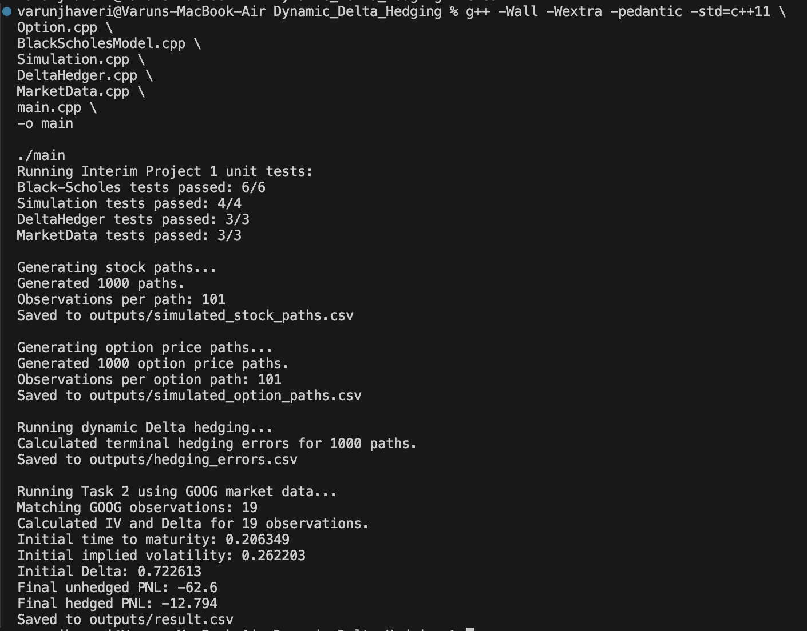
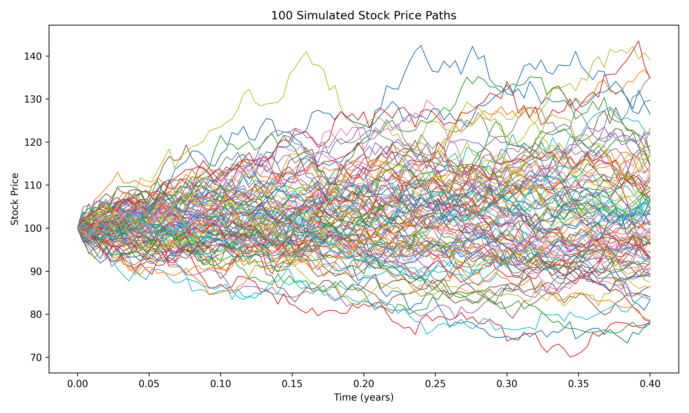
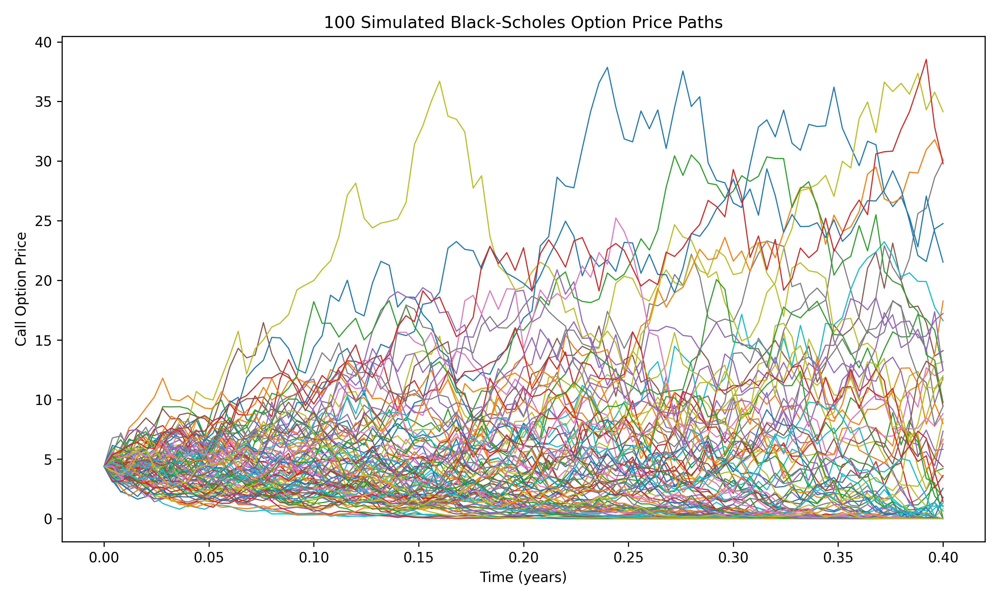
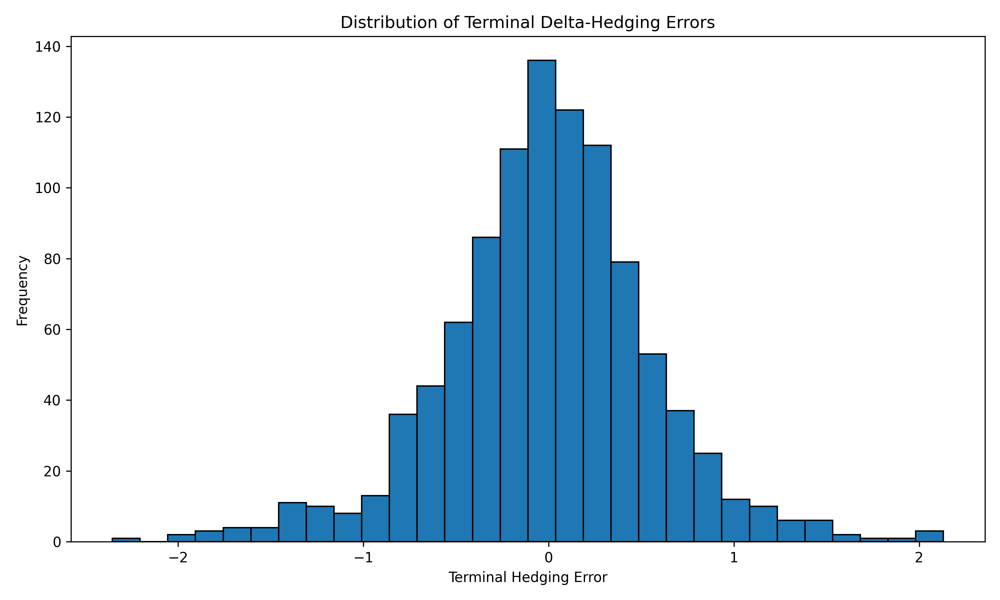
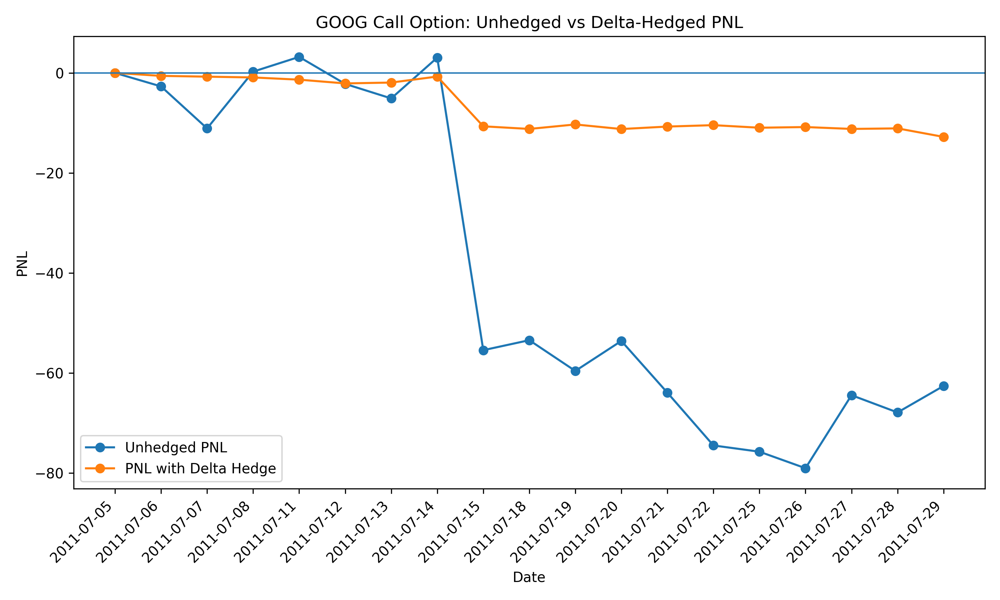

# Interim Project 1 — Dynamic Delta Hedging

**ISyE 6767 — Systems and Computation for Finance**  
**Fall 2026**

## 1. Problem and Objective

The objective of this project is to implement and evaluate a dynamic delta-hedging strategy for a European call option.

A short option position is hedged by holding \(\Delta\) shares of the underlying stock and maintaining the remaining value in a bank account. As the stock price, time to maturity, and volatility change, the hedge is rebalanced over time.

The project contains two parts:

1. Test the delta-hedging implementation using simulated stock-price paths and the Black-Scholes model.
2. Apply the same strategy to historical GOOG stock and option data and compare the profit and loss of an unhedged short call with a dynamically hedged position.

The project defines the cumulative hedging error as

\[
HE_i
=
\Delta_{i-1}S_i
+
B_{i-1}e^{r_{i-1}\Delta t}
-
V_i,
\]

where

\[
B_0=V_0-\Delta_0S_0
\]

and

\[
B_i
=
\Delta_{i-1}S_i
+
B_{i-1}e^{r_{i-1}\Delta t}
-
\Delta_iS_i.
\]

For the real-data experiment, unhedged PNL is defined as \(V_0-V_i\), while hedged PNL is the cumulative hedging error.

---

## 2. Models

### 2.1 Black-Scholes Model

For a European call option,

\[
C
=
S N(d_1)
-
K e^{-r\tau}N(d_2),
\]

where

\[
d_1
=
\frac{
\ln(S/K)
+
(r+\sigma^2/2)\tau
}{
\sigma\sqrt{\tau}
},
\]

and

\[
d_2=d_1-\sigma\sqrt{\tau}.
\]

The Black-Scholes call Delta is

\[
\Delta=N(d_1).
\]

The implementation also supports European puts.

### 2.2 Implied Volatility

For the real-market experiment, volatility is not assumed to be known. Instead, implied volatility is obtained by solving the Black-Scholes pricing equation for \(\sigma\).

A binary-search algorithm is used because it provides a stable numerical solution for the implied-volatility root.

The project instructions explicitly allow binary search or Newton's method for this calculation.

### 2.3 Stock Simulation

For Task 1, stock-price paths are generated using

\[
S_{t+\Delta t}
=
S_t
+
\mu S_t\Delta t
+
\sigma S_t\sqrt{\Delta t}Z_t,
\]

where \(Z_t\) is an independent standard normal random variable.

The parameters are

\[
S_0=100,\quad
T=0.4,\quad
\mu=0.05,\quad
\sigma=0.24,\quad
r=0.025,\quad
N=100.
\]

A total of 1,000 sample paths are generated. The European call has strike \(K=105\).

---

## 3. Implementation Structure

The implementation uses object-oriented C++.

### `Option`

Stores the option contract information:

- strike price
- expiration date
- call/put flag

### `BlackScholesModel`

Implements:

- Black-Scholes option pricing
- Delta calculation
- normal CDF
- implied-volatility estimation using binary search

### `Simulation`

Implements:

- simulation of stock-price paths
- generation of corresponding Black-Scholes option-price paths
- CSV export of simulation results

A fixed random seed is used to make the simulation reproducible.

### `DeltaHedger`

Implements:

- initial bank-account position
- daily portfolio rebalancing
- cumulative hedging-error calculation
- support for both constant and time-varying risk-free rates

### `MarketData`

Reads and processes:

- `interest.csv`
- `sec_GOOG.csv`
- `op_GOOG.csv`

The supplied interest rates are converted from percentage form to decimal form. Option market value is calculated using

\[
V_i
=
\frac{\text{best bid}+\text{best offer}}{2}.
\]

Time to maturity is computed using the trading calendar contained in the supplied GOOG data and 252 trading days per year. The assignment specifies these market-data definitions.

### `main.cpp`

Coordinates the complete workflow:

1. runs all unit tests;
2. generates Task 1 stock-price paths;
3. generates option-price paths;
4. performs simulated delta hedging;
5. loads GOOG market data;
6. calculates implied volatility and Delta;
7. calculates unhedged and hedged PNL;
8. writes all required output files.

---

## 4. Unit Testing

The implementation contains tests for all major numerical components.

The final test results were:

| Component | Tests Passed |
|---|---:|
| Black-Scholes | 6/6 |
| Simulation | 4/4 |
| DeltaHedger | 3/3 |
| MarketData | 3/3 |
| **Total** | **16/16** |

The tests include:

- Black-Scholes call price
- call Delta
- implied-volatility recovery
- put price and Delta
- payoff at expiration
- invalid implied-volatility inputs
- number and size of simulated paths
- correct initial simulated price
- reproducibility under a fixed random seed
- initial bank-account calculation
- hedging-error recursion
- GOOG contract extraction
- supplied market-data values
- trading-day time-to-maturity calculation

A successful program run showing all unit tests passing and the completion of both project tasks is shown below.

---

## 5. Task 1 — Simulation Results

The program generated 1,000 stock-price paths, each containing 101 observations including the initial stock price.

The first 100 paths are shown below.

For every simulated stock path, the corresponding Black-Scholes call-price path was calculated.

A dynamic Delta hedge was then constructed for each of the 1,000 simulated paths.

The terminal hedging-error statistics were:

| Statistic | Value |
|---|---:|
| Number of paths | 1000 |
| Mean | -0.006533 |
| Standard deviation | 0.564338 |
| Minimum | -2.35417 |
| Maximum | 2.13087 |

The distribution is shown below.

The mean hedging error is very close to zero, suggesting that the implementation does not exhibit a large systematic hedging bias under the Black-Scholes simulation.

The remaining dispersion is expected because the hedge is rebalanced at discrete time intervals rather than continuously. Changes in the stock price between hedge dates therefore produce residual hedging error.

---

## 6. Task 2 — GOOG Market Data

The real-data experiment uses the following call option:

\[
t_0=\text{2011-07-05},
\]

\[
t_N=\text{2011-07-29},
\]

\[
T=\text{2011-09-17},
\]

\[
K=500.
\]

These dates and strike correspond to the example required in the project specification.

A total of 19 market observations were matched.

For the first observation,

\[
S_0=532.44,
\]

\[
V_0=44.20,
\]

\[
\tau_0=\frac{52}{252}=0.206349.
\]

The calculated initial implied volatility was

\[
\sigma_{IV}=0.262203,
\]

and the corresponding Delta was

\[
\Delta_0=0.722613.
\]

For every trading date, `result.csv` contains:

- date
- stock price
- option price
- implied volatility
- Delta
- cumulative hedging error (HE)
- unhedged PNL
- PNL with hedge

as required by the project specification.

### PNL Results

At the final date,

\[
V_0=44.20
\]

and

\[
V_N=106.80.
\]

Therefore, the unhedged PNL is

\[
PNL_{\text{unhedged}}
=
44.20-106.80
=
-62.60.
\]

The final cumulative hedging error is

\[
PNL_{\text{hedged}}
=
-12.79396.
\]

The comparison is shown below.

The absolute loss was reduced by approximately

\[
79.56\%.
\]

Thus, the dynamic Delta hedge substantially reduced the exposure of the short call position to movements in GOOG's stock price.

---

## 7. Discussion

The simulation results demonstrate the expected behavior of Black-Scholes delta hedging. Under the same assumptions used to price the option, the average terminal hedging error across 1,000 paths is close to zero.

However, the error is not exactly zero because the theoretical Black-Scholes replication assumes continuous rebalancing, while the implementation rebalances only at discrete intervals.

The GOOG experiment illustrates additional limitations encountered in actual market data. Implied volatility changes from one date to another, interest rates vary through time, and option prices do not evolve exactly according to the assumptions of the Black-Scholes model.

Despite these limitations, the hedge substantially reduced the loss on the short call position. The unhedged position ended with a PNL of \(-62.60\), while the dynamically hedged position ended with a cumulative hedging error of approximately \(-12.79\).

Therefore, Delta hedging reduced directional stock-price exposure significantly but did not eliminate all option risk.

The experiment does not include transaction costs or dividends, consistent with the simplifying assumptions stated in the project.

---

## 8. Conclusion

This project successfully implemented a complete dynamic delta-hedging system using C++.

The system combines:

- Black-Scholes pricing
- analytical Delta
- implied-volatility estimation
- Monte Carlo stock simulation
- dynamic hedge rebalancing
- historical market-data processing
- PNL and hedging-error analysis

All 16 unit tests passed.

In the simulated Black-Scholes environment, the mean terminal hedging error was approximately zero, supporting the correctness of the implementation.

In the historical GOOG experiment, dynamic Delta hedging reduced the absolute loss from \(62.60\) to approximately \(12.79\), corresponding to a reduction of approximately \(79.56\%\).

The results demonstrate both the effectiveness and the practical limitations of dynamic Delta hedging: it can substantially reduce stock-price exposure, but discrete rebalancing and departures from idealized Black-Scholes assumptions leave residual hedging risk.