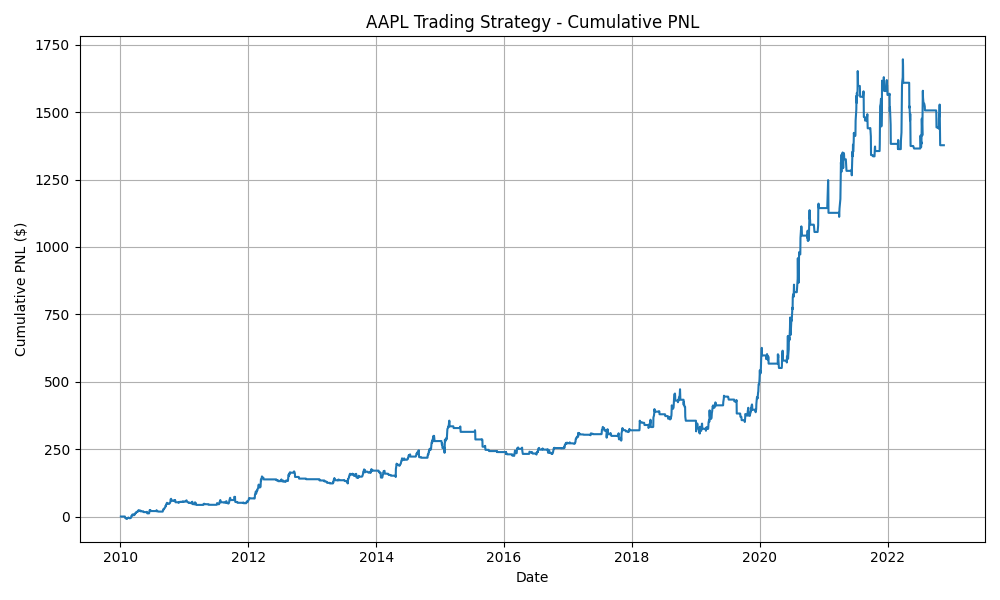

# Homework 4 — NumPy Exercise

**ISyE 6767 — Systems and Computation for Finance**  
**Fall 2026**

## 1. Problem 1 — Trading Strategy

### 1.1 Implementation

The first problem implements a rule-based trading strategy using NumPy arrays. The strategy begins with an account value of \$10,000 and trades 10 shares at a time.

For each trading day:

- If the stock price has increased for three consecutive days, 10 shares are purchased provided the current position is less than 20 shares.
- If the stock price has decreased for two consecutive days, the entire open position is sold.
- On the final day, any remaining position is liquidated.
- Otherwise, no action is taken.

The implementation maintains three NumPy arrays:

- `signals`: `1` for buy, `0` for hold, and `-1` for sell.
- `positions`: number of shares held after each day's action.
- `account_values`: cash plus the market value of the stock position.

For each date,

\[
\text{Account Value}_i
=
\text{Cash}_i
+
\text{Position}_i \times \text{Price}_i.
\]

The cumulative trading P&L is

\[
\text{Cumulative PNL}
=
\text{Final Account Value}
-
10000.
\]

The implementation runs in \(O(n)\) time for \(n\) trading days.

### 1.2 Provided Example

The provided price sequence is

\[
[98,100,102,104,103,101,99,100,102,104,106,107,105].
\]

The program produced

```text
Signals:
[ 0  0  0  1  0 -1  0  0  0  1  1  0 -1]

Positions:
[ 0  0  0 10 10  0  0  0  0 10 20 20  0]
```

These signals and positions exactly reproduce the example given in the assignment.

The corresponding account values were

```text
[10000. 10000. 10000. 10000.  9990.  9970.  9970.
  9970.  9970.  9970.  9990. 10010.  9970.]
```

The final cumulative P&L for the example was

\[
\boxed{-\$30.00}.
\]

### 1.3 Custom Unit Test

A separate example was constructed to test the implementation:

```text
Prices:
[10, 11, 12, 13, 14, 13, 12, 11, 12, 13, 14, 15]
```

The expected and actual signals were

```text
[0, 0, 0, 1, 1, 0, -1, 0, 0, 0, 1, -1]
```

and the positions were

```text
[0, 0, 0, 10, 20, 20, 0, 0, 0, 0, 10, 0]
```

The cumulative P&L was

\[
\boxed{-\$20.00}.
\]

Assertions comparing the generated signals, positions, and P&L with these expected values all passed.

### 1.4 AAPL Historical Data

The strategy was then applied to the supplied AAPL historical data.

The program generated `trading_results.csv`, containing the following columns:

| Column | Description |
|---|---|
| Date | Trading date |
| Signal | Buy, hold, or sell decision |
| Position | Number of shares held |
| Account Value | Cash plus stock-market value |

The AAPL dataset contained 3,244 trading days. The initial account value was

\[
\$10,000.00,
\]

and the final account value was

\[
\$11,377.38.
\]

Therefore, the cumulative trading P&L was

\[
\boxed{\$1,377.38}.
\]

The cumulative P&L over the complete historical period is shown below.



The strategy generated a positive total return over the supplied historical period. The P&L path was not monotonic; periods of gains and losses occurred as the price-based trading rules opened and closed positions. The final result demonstrates that the specified strategy produced an overall profit on this AAPL dataset, although this result alone does not imply that the strategy would remain profitable on other stocks or time periods.

---

## 2. Problem 2 — Energy Maze

### 2.1 Implementation

The second problem determines the minimum initial energy required to move from the top-left cell of a maze to the bottom-right cell while moving only right or down and never allowing energy to fall below 1.

The problem is solved using dynamic programming with a NumPy array.

Let

\[
dp[i][j]
\]

represent the minimum amount of energy required when entering cell \((i,j)\).

Since the solution depends on the amount of energy required in future cells, the maze is processed backwards from the bottom-right corner.

For an interior cell,

\[
dp[i][j]
=
\max
\left(
1,\;
\min(dp[i+1][j],dp[i][j+1])
-
maze[i][j]
\right).
\]

The `min` chooses the better of moving down or right. The `max(1,\cdot)` guarantees that the energy level never falls below 1.

For an \(m\times n\) maze, the implementation requires

\[
O(mn)
\]

time and

\[
O(mn)
\]

space.

### 2.2 Provided Example

The maze supplied in the assignment is

\[
\begin{bmatrix}
-2 & -3 & 3\\
-5 & -10 & 1\\
10 & 30 & -5
\end{bmatrix}.
\]

The program produced

```text
Minimum Initial Energy:
7
```

Therefore,

\[
\boxed{\text{Minimum Initial Energy}=7}.
\]

This exactly reproduces the result given in the assignment.

### 2.3 Custom Example and Unit Tests

A custom maze was constructed:

\[
\begin{bmatrix}
1 & -4 & 5\\
-2 & -3 & -1
\end{bmatrix}.
\]

The program returned

\[
\boxed{\text{Minimum Initial Energy}=4}.
\]

This result was checked using an assertion and passed.

Two additional boundary cases were tested.

For

\[
\begin{bmatrix}
5
\end{bmatrix},
\]

the required initial energy is

\[
1.
\]

For

\[
\begin{bmatrix}
-5
\end{bmatrix},
\]

the required initial energy is

\[
6.
\]

All custom Energy Maze tests passed.

---

## 3. Conclusion

Both NumPy exercises were successfully implemented in `hw4.py`.

For Problem 1, the implementation exactly reproduced the trading signals and positions from the provided example, passed an independently constructed unit test, generated the required `trading_results.csv`, and produced a cumulative P&L of **\$1,377.38** on the supplied AAPL data.

For Problem 2, the dynamic-programming implementation reproduced the required minimum initial energy of **7** for the provided maze and also passed custom and boundary test cases.

The final implementation therefore satisfies the required functionality for both the trading-strategy and Energy Maze problems while using NumPy arrays as required.