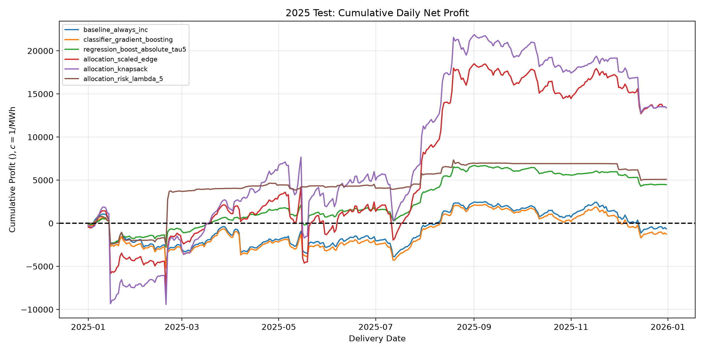

# Interim Project II: Virtual Bidding Strategy in Power Markets
**ERCOT North Hub — ISyE 6767, Systems for Computational Finance**

## 1. Introduction

This project develops and evaluates a virtual bidding strategy for ERCOT's North Hub (HB NORTH). The objective is to forecast the difference between day-ahead (DA) and real-time (RT) settlement prices and allocate virtual trading volume across delivery hours.

The hourly spread is defined as:

\(S_{D,h}=P^{DA}_{D,h}-P^{RT}_{D,h}\).

An INC position profits when the spread is positive; a DEC position profits when it is negative. For trading action \(a\), volume \(v\) MWh, and transaction cost \(c\) per MWh, realized profit is:

\(\pi_{D,h}=v_{D,h}(a_{D,h}S_{D,h}-c)\).

We investigate three related problems: predicting spread direction, predicting spread magnitude, and allocating a daily trading budget. The emphasis is on out-of-sample performance, risk, reproducibility, and the difference between statistical accuracy and economic profitability.

## 2. Data Preparation and Methodology

### 2.1 Data and chronological split

The analysis uses ERCOT day-ahead and real-time prices together with load, wind, and solar forecasts. The raw files cover December 2022 through December 2025.

The chronological data split is:

| Period | Purpose | Observations |
|---|---|---:|
| December 2022 | Historical lags | 744 |
| 2023 | Model training | 8,760 |
| 2024 | Validation and model selection | 8,784 |
| 2025 | Final out-of-sample testing | 8,760 |

Model specifications, trading thresholds, and risk preferences were selected using 2024 validation results. The 2025 holdout was reserved for final evaluation and was not used to retune the models.

### 2.2 Cleaning and data integrity

The data-cleaning pipeline was developed from the professor's Lab 2 notebook and regenerates `ercot_hb_north_hourly.csv` from the supplied raw files.

Day-ahead prices were filtered to HB NORTH. Real-time prices were aggregated from four 15-minute intervals per hour. ERCOT's hour-ending convention was converted to unique UTC timestamps, accounting for 23-hour spring-forward days and 25-hour fall-back days.

Forecast posting records were verified against the decision deadline of 9:00 AM Central Time on the day preceding delivery. All 3,381 posting records passed this check.

Three solar forecast values were missing because of inconsistent spring daylight-saving labels. The affected nighttime forecasts were filled with zero after their dates and hours were explicitly verified. These are the only forecast imputations applied during dataset construction.

The resulting hourly dataset contains 27,048 observations and 14 columns, with no missing values. Extreme and negative settlement prices were retained, rather than removed or clipped, because they represent legitimate market outcomes. Across 2023–2025, six hours had negative DA prices, 538 had negative RT prices, and 541 had at least one negative price.

### 2.3 Decision-time information and look-ahead prevention

All trades for delivery day \(D\) are decided at 9:00 AM on \(D-1\). Accordingly, delivery-day realized DA and RT prices, spreads, and classification labels cannot enter the model features.

The feature matrix contains 22 variables grouped into calendar features; DA, RT, and spread lags at D−2 and D−7; same-hour rolling spread statistics; load and renewable forecasts; and derived net-load and ramp variables.

Historical price features use calendar-date and hour-ending alignment rather than fixed 24-hour row shifts, which can fail around daylight-saving transitions. Rolling price statistics end at D−2. Missing historical lag features are handled within training-fitted preprocessing pipelines.

The Lab 2 `assert_no_lookahead` test was applied to the engineered features, including the final 2025 evaluation, and passed.

## 3. Part 1: Direction Prediction

### 3.1 Baselines and classification models

The binary classification label is \(y_{D,h}=\mathbf{1}\{S_{D,h}>0\}\). We implemented Always INC, Always DEC, persistence based on the spread at D−2 and D−7, and the majority spread direction for each hour of the week using the training data.

We then fitted logistic regression and histogram gradient-boosted classification models. An additional heuristic predicts direction using the sign of the historical 28-day same-hour mean spread.

All direction strategies use a 1 MWh position per delivery hour in the initial comparison.

### 3.2 Validation and test results

| Model | 2024 accuracy | 2024 net profit | 2025 net profit |
|---|---:|---:|---:|
| Always INC | 54.4% | $1,507 | −$647 |
| D−2 persistence | 52.3% | $2,523 | −$4,094 |
| Seasonal majority | 55.0% | −$8,099 | −$3,645 |
| Logistic regression | 55.8% | $3,360 | −$574 |
| Gradient boosting | 57.7% | $10,889 | −$1,263 |
| Rolling-mean heuristic | 54.0% | −$3,735 | −$9,105 |

All profits are net of the specified $1/MWh transaction cost.

For the 2025 holdout, logistic regression achieved 62.48% accuracy, 0.5002 balanced accuracy, 0.5201 ROC-AUC, and 0.7132 log loss. Gradient boosting achieved 61.64% accuracy, 0.5032 balanced accuracy, 0.5493 ROC-AUC, and 0.7050 log loss.

Thus, gradient boosting retained better ranking performance and log loss, but neither classifier produced positive 2025 net profit when trading 1 MWh every hour.

### 3.3 Classification versus regression framing

Classification estimates the probability that the spread is positive, but assigns equal importance to small and large spreads. Correctly predicting a $0.10 spread has the same contribution to classification accuracy as correctly predicting a $200 spread, even though the economic consequences differ substantially.

A classifier may be preferable when directional probabilities are reliable and the primary goal is sign prediction or trade filtering. Signed regression is useful when trade selection depends on the expected size of an opportunity relative to costs.

Our results illustrate the distinction. Gradient boosting was the strongest classification model on validation data, but generated a loss in 2025. In contrast, cost-filtered signed regression remained profitable. This agrees with the general finding of Maciejowska, Nitka, and Weron (2019) that sign accuracy and economic profitability need not coincide.

The results also motivate spike-aware forecasting, as investigated by Hubert, Lolas, and Sircar (2026). However, our binary classification experiments predict spread sign, not their specific positive- and negative-spike targets.

## 4. Part 2: Spread Magnitude Forecasting

### 4.1 Regression models and loss functions

Two prediction targets were investigated:

**View A:** Unsigned magnitude, \(|S|\), describing the expected scale of an opportunity or risk.

**View B:** Signed spread, \(S\), providing a direction and a magnitude-based trading signal.

For each target, we compared Ridge regression, gradient boosting with squared-error loss, and gradient boosting with absolute-error loss. Performance was evaluated using MAE and RMSE.

### 4.2 Regression performance

| Target | Model | 2025 MAE | 2025 RMSE |
|---|---|---:|---:|
| Signed | Ridge, squared loss | 15.920 | 41.916 |
| Signed | Boosting, squared loss | 24.517 | 67.671 |
| **Signed** | **Boosting, absolute loss** | **11.441** | **40.813** |
| Magnitude | Ridge, squared loss | 27.769 | **47.931** |
| Magnitude | Boosting, squared loss | 14.695 | 63.545 |
| Magnitude | Boosting, absolute loss | **10.792** | 51.200 |

Absolute-error boosting achieved the lowest MAE for both views and the lowest RMSE for signed spread prediction. Ridge achieved the lowest RMSE for unsigned magnitude, despite its substantially higher MAE.

The difference is consistent with the effect of the training losses: squared-error loss heavily penalizes large residuals, whereas absolute-error loss is less sensitive to extreme observations. In a heavy-tailed electricity market, the loss function materially changes the fitted forecasts.

### 4.3 Transaction costs and trading thresholds

For signed predictions, trades are entered only when the predicted spread exceeds the transaction cost plus an additional threshold \(\tau\). Otherwise, no trade is placed.

We evaluated \(\tau\in\{0,1,2,5,10\}\) on 2024 validation data.

For absolute-error gradient boosting with \(c=\$1/\text{MWh}\):

| Threshold | Trades | Validation net profit | Profit/MWh |
|---|---:|---:|---:|
| 0 | 6,755 | $4,359 | $0.65 |
| 1 | 4,853 | $7,202 | $1.48 |
| 2 | 3,548 | $11,774 | $3.32 |
| **5** | **1,599** | **$13,565** | **$8.48** |
| 10 | 734 | $13,521 | $18.42 |

We selected \(\tau=5\) because it produced the highest total validation net profit among the tested thresholds. On 2025 test data, the corresponding fixed-size signed regression strategy generated $4,473 net profit across 2,574 trades.

Higher thresholds reduce participation and concentrate trading in higher-predicted-edge hours. However, higher predicted spreads do not guarantee better realized outcomes, especially during scarcity or spike conditions.

### 4.4 Trade sizing and the two regression views

We compared fixed 1 MWh positions, volume proportional to predicted edge, and risk-adjusted sizing using the historical 28-day spread standard deviation. Within each forecasting view, all three methods traded the same eligible hours and identical total MWh.

On the 2025 holdout:

| View and sizing | Traded MWh | Net profit | Profit/MWh |
|---|---:|---:|---:|
| Signed, fixed | 2,574 | $4,473 | $1.74 |
| Signed, edge-based | 2,574 | $25,048 | $9.73 |
| Signed, risk-adjusted | 2,574 | $16,500 | $6.41 |
| Classifier + magnitude, fixed | 1,722 | $4,659 | $2.71 |
| Classifier + magnitude, edge-based | 1,722 | $23,933 | $13.90 |
| Classifier + magnitude, risk-adjusted | 1,722 | $16,607 | $9.64 |

Edge-based sizing achieved the highest profit within each view. The two views trade different total volumes, so their total profits are not a controlled equal-volume comparison with each other.

The combined classifier-magnitude signal is \((2p-1)\widehat{|S|}\). It estimates the conditional expected signed spread only under additional assumptions, notably conditional independence of direction and magnitude, or equality of conditional magnitudes for positive and negative spreads.

In general:

\(E[S\mid x]=pE[|S|\mid S>0,x]-(1-p)E[|S|\mid S<0,x]\).

Consequently, a large magnitude forecast may represent either opportunity or downside risk. More aggressive sizing is reasonable only when the predicted edge is credible relative to uncertainty. This motivates the budget-constrained and risk-aware methods in Part 3.

The Part 2 sizing strategies enforce an hourly volume cap but not the Part 3 daily budget. Their profits should therefore not be directly compared to the budget-constrained results as if capital constraints were identical.

## 5. Part 3: Trading Budget Allocation

### 5.1 Trading constraints and methods

The allocation experiments impose a maximum daily volume of 24 MWh and maximum hourly volume of 4 MWh.

We compared three full-budget scaling strategies (equal weights, predicted edge, and edge divided by squared volatility), an integer-volume knapsack allocation, and risk-aware quadratic allocation with risk-aversion coefficients \(\lambda=0.1,1,5\).

The knapsack method allocates to the largest positive predicted net edges subject to a minimum trading threshold. It can leave budget unused when opportunities are weak.

### 5.2 Why full-budget scaling can fail

Always spending the full daily budget may force trades when all predicted edges are small or dominated by estimation noise. It also concentrates positions in unusually large forecasts, which may correspond to poorly predicted price spikes.

Unadjusted scaling treats equal predicted edges similarly even if their risks are very different. Exposure across neighboring hours does not necessarily diversify risk because hourly electricity spreads may be correlated. Finally, scaling based on raw forecast magnitudes is sensitive to model calibration: incorrectly scaled forecasts can distort allocation even if their ranking is useful.

These limitations explain why flexible participation and explicit risk controls can be valuable.

### 5.3 Knapsack formulation and weighted example

In the assignment's integer-volume knapsack, every additional MWh consumes one unit of the 24 MWh budget and has the same expected value within an hour. Consequently, sorting positive expected edges and selecting the highest-valued units gives the optimal solution.

If items consume unequal budget weights, greedy sorting by expected profit is no longer generally optimal.

For example, consider three hypothetical trades with risk-budget weights (2, 3, 4), expected profits ($3, $4, $5), and a risk budget of 6. Dynamic programming selects trades 1 and 3, consuming six units and achieving the optimal expected profit of $8.

The dynamic-programming solution has \(O(nB)\) time complexity for \(n\) items and integer budget \(B\).

### 5.4 Risk-aware allocation

The risk-aware method maximizes a predicted-edge objective with a quadratic risk penalty:

\(\max_v\; e^\top v-\frac{\lambda}{2}v^\top\widehat{\Sigma}v\),

subject to hourly and daily volume limits.

The covariance estimate uses 2023 historical spreads, with covariance shrinkage and scale normalization. It is adjusted for the predicted trade directions. The resulting quadratic programs are solved with OSQP.

Because covariance was normalized, the values of \(\lambda\) are experimental risk-penalty settings, not directly interpretable monetary risk aversion coefficients.

### 5.5 Budget-constrained results

| Strategy | 2024 net profit | 2025 net profit | 2025 budget used |
|---|---:|---:|---:|
| Knapsack | $42,596 | **$13,419** | 81.2% |
| Scaled edge | $26,678 | $13,401 | 100.0% |
| Scaled equal | $2,818 | −$1,384 | 100.0% |
| Scaled risk | $5,441 | $3,529 | 100.0% |
| Risk-aware, λ = 0.1 | $27,173 | $814 | 36.3% |
| Risk-aware, λ = 1 | $22,536 | −$2,609 | 26.7% |
| Risk-aware, λ = 5 | $23,162 | $5,088 | 14.3% |

Knapsack and scaled edge earned nearly identical 2025 profits, despite using different amounts of the available budget.

The key risk metrics are:

| Strategy | 2025 profit/MWh | Maximum drawdown | Annualized P&L Sharpe |
|---|---:|---:|---:|
| Knapsack | $1.89 | $11,304 | 0.706 |
| Scaled edge | $1.53 | $9,096 | 0.842 |
| Risk-aware, λ = 5 | $4.06 | **$3,299** | 0.775 |

The high-risk penalty strategy substantially reduced drawdown but also reduced traded volume and overall profit. Knapsack earned the highest net profit, while scaled edge achieved a slightly better observed Sharpe ratio and smaller maximum drawdown.

The annualized Sharpe metric uses daily net P&L, zero benchmark return, and a 365-day annualization convention.

### 5.6 Extreme days and profit concentration

The five worst knapsack days in 2025 were:

| Delivery day | Daily net loss |
|---|---:|
| January 15 | −$10,441 |
| May 16 | −$8,703 |
| February 19 | −$3,370 |
| December 14 | −$2,822 |
| May 8 | −$2,549 |

The five most profitable days accounted for 142.3% of knapsack's annual net profit. Therefore, the remaining trading days collectively contributed a net loss.

This illustrates the sensitivity of virtual bidding returns to extreme settlement-price events. Annual profitability alone provides an incomplete description of strategy reliability.

## 6. Feature Ablation

We tested the importance of three feature categories by removing each group and retraining the models using the same chronological split.

| Feature set | Classifier accuracy | Classifier profit | Signed regression MAE | Regression profit |
|---|---:|---:|---:|---:|
| Full model | 57.7% | $10,889 | 12.452 | $13,565 |
| Without price history | 57.0% | $5,571 | 13.910 | $14,320 |
| Without forecasts | 57.9% | $7,680 | 12.414 | $6,304 |
| Without calendar | 57.5% | $10,152 | 12.534 | $12,534 |

These are 2024 validation results.

Removing price history reduced classifier profitability and worsened regression MAE. Removing forecasts slightly improved some point-forecasting metrics but substantially reduced trading profits. Calendar features provided smaller, yet observable, benefits.

The no-price-history regression generated slightly higher total profit than the full model, but also made more trades and earned less profit per MWh. Thus, ablation effects depend on the evaluation metric, not merely the number of features retained.

The complete 22-feature model was retained for final evaluation based on the overall validation evidence and assignment-specified feature set.

## 7. Annualized Return and Risk Interpretation

The assignment specifies MWh trading limits but does not specify actual posted collateral or invested capital. Therefore, annualized return on capital is reported using an illustrative $100,000 constant capital assumption.

For the 2025 holdout, knapsack generated approximately 13.4% net P&L relative to that assumed capital, scaled edge also generated approximately 13.4%, and risk-aware allocation with \(\lambda=5\) generated approximately 5.1%.

These are illustrative capital-normalized P&L figures, not independently verified investment returns. Actual return on capital would depend on market collateral, margin rules, and liquidity requirements.

## 8. Limitations and Discussion

Several limitations affect the interpretation of these findings.

First, settlement-price spreads are heavy-tailed and sensitive to rare events. The most extreme profitable and unprofitable days make a disproportionate contribution to total returns, creating substantial uncertainty about future performance.

Second, the predictive features rely on historical market relationships. Those relationships may change because of weather regimes, generation mix, market structure, or participant behavior. The differences between 2024 validation and 2025 testing demonstrate the importance of out-of-sample evaluation.

Third, the models use a limited history and fixed training period. A rolling or expanding retraining experiment could be investigated in future work, but was not selected using the final test data.

Fourth, the forecast information is also available to the day-ahead market. Consequently, publicly available forecasts may already be incorporated into prices. Predicting a positive spread does not necessarily imply an exploitable informational advantage.

Fifth, the risk-aware model uses a historical covariance estimate, which may not capture time-varying volatility, nonlinear dependence, or rare joint extremes. A scenario-based CVaR limit or explicit worst-day loss constraint would provide a complementary approach.

Finally, the simulation does not explicitly model market impact, bid acceptance, price sensitivity to virtual bidding volume, or actual collateral requirements. Li, Yu, and Wang (2021) demonstrate why incorporating risk and price sensitivity is relevant to virtual bidding portfolio design.

## 9. Conclusion

The results show that forecasting DART spread direction and generating profitable virtual bidding strategies are distinct problems. Direction classifiers achieved reasonable accuracy but generally struggled to overcome transaction costs in the 2025 holdout.

Signed spread regression with cost-aware thresholds offered greater trading selectivity. Edge-proportional volume sizing improved realized profits, although Part 2 results were not directly constrained by the full daily budget.

Under the 24 MWh daily limit, knapsack produced the highest 2025 net profit, while scaled-edge allocation achieved nearly identical profitability with lower drawdown and higher observed Sharpe. Risk-aware allocation substantially reduced exposure and maximum drawdown, at the expense of profit.

The central conclusion is that reliable virtual bidding requires not only directional forecasting but also careful attention to spread magnitude, transaction costs, position sizing, risk constraints, and tail-event concentration.

## References

1. Hubert, E., Lolas, D., and Sircar, R. (2026). *Trading Electrons: Predicting DART Spread Spikes in ISO Electricity Markets*. https://arxiv.org/abs/2601.05085

2. Maciejowska, K., Nitka, W., and Weron, T. (2019). *Day-Ahead vs. Intraday—Forecasting the Price Spread to Maximize Economic Benefits*. Energies, 12(4), 631. https://doi.org/10.3390/en12040631

3. Li, Y., Yu, N., and Wang, W. (2021). *Machine Learning-Driven Virtual Bidding with Electricity Market Efficiency Analysis*. https://arxiv.org/abs/2104.02754

4. ERCOT. Historical Day-Ahead and Real-Time Settlement Point Prices; Seven-Day Load Forecast; Wind Power Production Forecast; and Solar Power Production Forecast. Supplied through the ISyE 6767 Lab 2 dataset.
